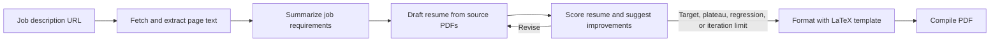

# EazApply

EazApply tailors a resume to a job description, iteratively reviews the draft against the role, and generates a formatted PDF. It uses the LLM7 API for resume drafting, ATS-style scoring, LaTeX formatting, and limited LaTeX repair.

## How it works



The revision loop stops when the ATS-style score reaches **9.5/10**, the score improves by less than **0.1**, the score regresses, or the workflow has generated **five drafts**. The highest-scoring draft is used for final formatting.

If LaTeX compilation fails, EazApply asks LLM7 to repair the source and retries up to two times. If compilation still fails, the `.tex` and compiler `.log` are retained for troubleshooting.

## Requirements

- Python 3.10 or later
- An [LLM7 API key](https://llm7.io/)
- A LaTeX distribution that provides `pdflatex`, such as [MiKTeX](https://miktex.org/) or TeX Live
- A job-description page that can be fetched without an authenticated browser session

## Setup

### 1. Clone the repository and create a virtual environment

```bash
git clone https://github.com/Stormn13/eazapply.git
cd eazapply
python -m venv .venv
```

Activate it:

```powershell
# Windows PowerShell
.\.venv\Scripts\Activate.ps1
```

```bash
# macOS or Linux
source .venv/bin/activate
```

### 2. Install Python dependencies

```bash
python -m pip install --upgrade pip
python -m pip install langgraph langchain-openai langchain-community langchain-core python-dotenv pydantic requests beautifulsoup4 pypdf
```

### 3. Configure LLM7

Create a `.env` file in the repository root:

```dotenv
LLM7_API_KEY=your_llm7_api_key
```

Keep the key private. `.env` is ignored by Git; do not commit it or paste the key into issues or logs.

### 4. Add your source resumes

Place one or more PDF resumes under `user_data/`. For example:

```text
user_data/
└── career_sources/
    ├── resume.pdf
    └── project_resume.pdf
```

The workflow searches recursively under `user_data/` for source PDFs and excludes `user_data/generated/`, so previously generated resume PDFs are not reused as source material.

### 5. Set the job-description URL

Edit the `jd_link` value in `main.py` to the job posting you want to target. Some sites, including LinkedIn, may block automated requests or require a login; use a page that is publicly accessible to the application.

## Run

Ensure `pdflatex` is available on your `PATH`, then run:

```bash
python main.py
```

The terminal prints the path to the completed PDF. Generated files are saved in `user_data/generated/` and named from a short role label suggested by the model, for example:

```text
user_data/generated/
├── machine-learning-intern.tex
├── machine-learning-intern.pdf
└── machine-learning-intern.log
```

If a name already exists, a numeric suffix is added (for example `machine-learning-intern-2.pdf`) instead of overwriting existing output. Generated artifacts are excluded from Git.

## Tests

Run the focused workflow tests with:

```bash
python -m unittest discover -s tests -p "test_resume_workflow.py"
```

## Notes

- The ATS score is an LLM-generated estimate for comparing drafts, not a score from a specific employer's ATS.
- Resume content is intended to be grounded in the supplied PDFs. Review the generated resume for accuracy before using it.
- The LaTeX layout comes from [`resume_format/format.tex`](resume_format/format.tex). Update that file to customize the resume template.
- PDF creation requires `pdflatex` and any packages used by the template. On a first MiKTeX compile, it may prompt to install missing LaTeX packages.
